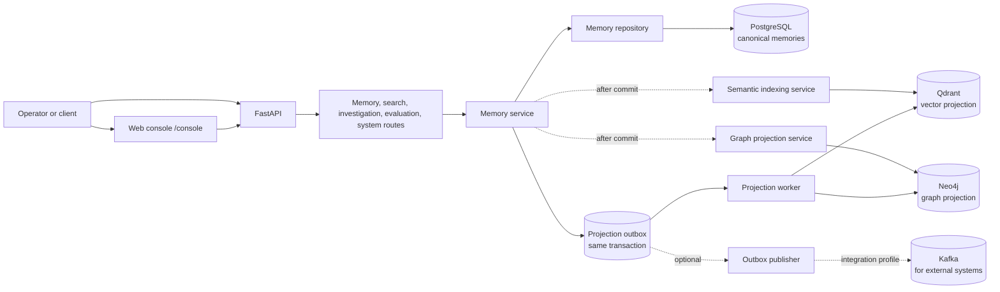
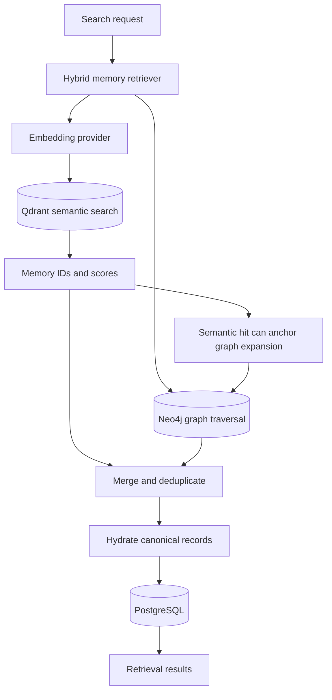
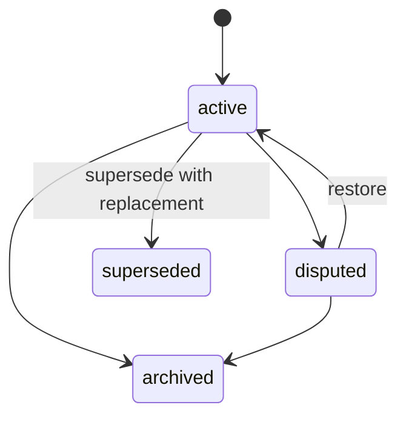
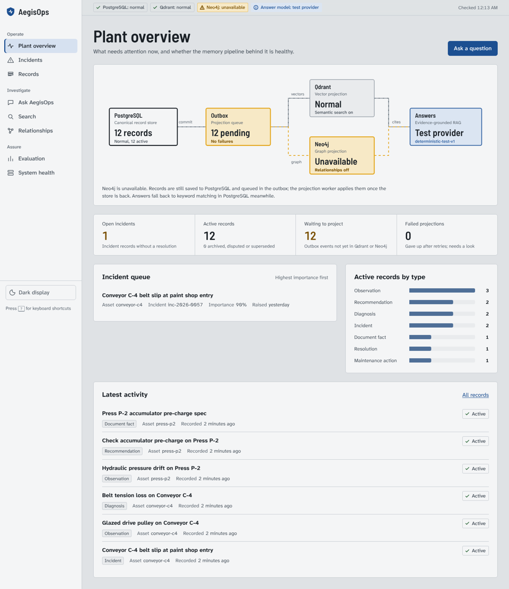
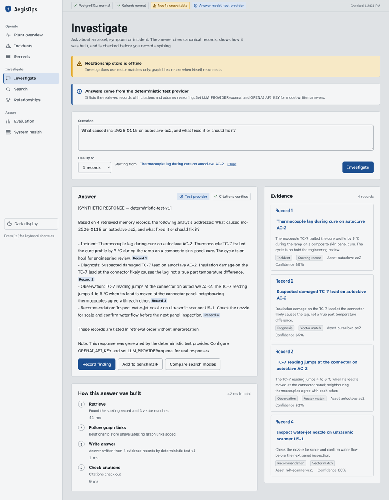
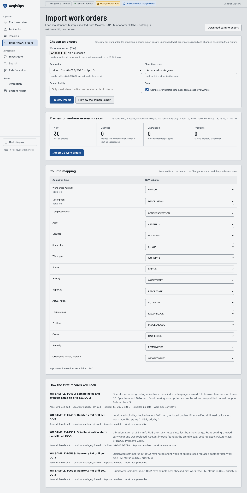

# AegisOps

**Operational memory for infrastructure and industrial asset operations.** AegisOps captures observations, incidents, diagnoses, actions, and resolutions, then makes them available through semantic, graph, and hybrid retrieval.

[Quickstart](#quickstart) · [Architecture](#architecture) · [API](#api) · [Testing](#testing) · [Retrieval evaluation](#retrieval-evaluation) · [Configuration](#configuration)

<details>
<summary>At a glance</summary>

| Concern | AegisOps component |
| --- | --- |
| Canonical memory and lifecycle | PostgreSQL |
| Semantic index | Qdrant |
| Entity and relationship projection | Neo4j |
| Durable projection events | PostgreSQL outbox (Kafka optional, for external consumers) |
| HTTP API and OpenAPI docs | FastAPI |
| Operator experience | Web console served by the API at `/console` |
| Projection delivery | Outbox projection worker (PostgreSQL outbox to Qdrant and Neo4j) |
| Investigations | Retrieve once, follow graph links, cited answer, citation check, then an operator-confirmed finding |
| Retrieval evaluation | One retriever and one metrics module shared by the API, console and recorded CLI benchmark |

</details>

## Architecture

PostgreSQL owns canonical memory content. Qdrant and Neo4j are derived retrieval projections. Every write commits the record and its outbox events in one transaction; the API then makes a best-effort synchronous projection, and the **projection worker** drains the outbox so that any projection missed while a store was down is applied once it returns. A successful database commit is never rolled back when an index operation fails.

Kafka is optional. With the `integration` compose profile and `KAFKA_ENABLED=true`, the outbox publisher also emits every committed event to a Kafka topic for external systems such as a CMMS or MES. Nothing inside AegisOps consumes that topic, and nothing depends on it.



### Retrieval path



**Retrieval contract:** Qdrant and Neo4j return candidate memory IDs. PostgreSQL hydrates the canonical records returned by the API, and only `active` records are returned unless the request sets `include_inactive`, so archived, disputed and superseded memories never become answer evidence by accident. In graph mode, supply an `anchor_memory_id` when the query does not otherwise provide an anchor. When neither projection store returns candidates, GraphRAG falls back to a bounded PostgreSQL keyword match and reports `retrieval_mode: "keyword_fallback"`.

### Memory lifecycle



## Quickstart

<details open>
<summary>Start the local stack</summary>

**Requirements:** Docker Desktop or Docker Engine with Compose v2.

1. Configure local environment:

   ```bash
   cp .env.example .env
   ```

   Set a local `POSTGRES_PASSWORD` in `.env`. For anything beyond local development, use managed secrets and rotate credentials.

2. Build and start services:

   ```bash
   docker compose up -d --build
   ```

3. Create or upgrade the database schema:

  ```bash
  docker compose exec -T api alembic upgrade head
  ```

4. Check status and health:

   ```bash
   docker compose ps
   curl http://localhost:8000/health
   curl http://localhost:8000/api/v1/system/health
   ```

5. Open the interactive API documentation:

   - Swagger UI: <http://localhost:8000/docs>
   - ReDoc: <http://localhost:8000/redoc>
   - Web console: <http://localhost:8000/console> (also the redirect target of `/`)
   - Qdrant dashboard: <http://localhost:6333/dashboard>
   - Neo4j Browser: <http://localhost:7474>

</details>

### Compose services

| Service | Purpose | Local endpoint |
| --- | --- | --- |
| `api` | FastAPI memory, retrieval, health, and observability routes | `http://localhost:8000` |
| `postgres` | Canonical memory database and projection outbox | `localhost:5432` |
| `qdrant` | Vector index | `http://localhost:6333` |
| `neo4j` | Graph projection and traversal | `http://localhost:7474`, Bolt `localhost:7687` |
| `projection-worker` | Applies pending outbox events to Qdrant and Neo4j with bounded retries | Internal service |
| `kafka`, `kafka-init`, `outbox-publisher` (profile `integration`) | Optional outbound event stream for external systems | `docker compose --profile integration up -d`, then set `KAFKA_ENABLED=true` |

## Web console

The API serves an operator console at `/console`. Its pages are one operational loop, and each page links to the next step:

```mermaid
flowchart LR
    W[Import work orders<br/>CMMS history] --> R[Records]
    R --> V
    O[Plant overview<br/>what needs attention] --> I[Incidents<br/>timeline per incident]
    I --> V[Investigate<br/>cited answer + checks]
    S[Search] --> V
    G[Relationships] --> V
    V -- operator confirms --> F[Finding recorded<br/>on the incident]
    F --> I
    V -- operator labels evidence --> E[Evaluation<br/>recall@k, MRR]
    E -- export queries.jsonl --> CLI[Recorded CLI benchmark]
    H[System health<br/>what powers each page] -.-> O
```

| Page | Operational job | Leads to | API |
| --- | --- | --- | --- |
| Plant overview | Open incidents, pipeline state, projection backlog. Every pipeline stage opens the page it powers | Incidents, Records, Investigate, System health | `/memories`, `/system/outbox-stats` |
| Incidents | Everything recorded against one incident, in order; add to it | Investigate this incident, Relationships, asset records | `/memories` |
| Records | Canonical records with lifecycle actions (dispute, archive, supersede) | Investigate from a record, Relationships, Incident, Import | `/memories/*` |
| Import work orders | Preview, map columns and load a CMMS work-order export; re-imports skip unchanged rows and supersede changed ones | Records (filtered to work orders), Investigate, System health | `/imports/work-orders` |
| Investigate | One retrieval, graph links, a cited answer, a citation check, and how it was built. Starting from a record scopes the evidence to its incident or asset | Record finding (back to the incident), Add to benchmark, Search | `/investigations`, `/investigations/findings` |
| Search | The three retrieval modes the benchmark measures | Investigate, Relationships | `/search/hybrid` |
| Relationships | Records linked through asset, line, incident, source or supersession | Records, Incidents, Investigate | `/search/graph-related` |
| Evaluation | Labelled questions, recall@k and MRR per mode, export for the recorded benchmark | Search, Investigate | `/evaluation/runs` |
| System health | Each service, what it powers, projection backlog, investigation metrics | Every affected page | `/system/*` |

Findings are human-confirmed: an investigation never writes a record by itself. **Record finding** goes through the same promotion policy as any promoted memory (confidence at least 0.6, importance at least 0.4, at least one evidence record). The finding stores its evidence IDs and question, and inherits the asset and incident of the record you started from. **Add to benchmark** never pre-ticks relevance; the operator labels which records a correct answer needs.





Design follows ANSI/ISA-101 high-performance HMI practice: a calm grey display where colour is reserved for abnormal states, and every state also carries an icon and a word. It targets WCAG 2.2 AA: keyboard operation throughout (press `?` for shortcuts), visible focus, landmarks and a skip link, labelled forms with inline errors, reduced-motion support, light and dark displays, and a stacked layout on phones. It has no build step and no third-party runtime dependencies; fonts are bundled so it renders the same on networks without internet access. The sample plant (aerospace manufacturing: a drilling cell, an autoclave, an ultrasonic scanner) is invented, flagged `is_synthetic`, and labelled "Sample data".

## Importing work-order history

A pilot should run on the plant's own maintenance history, not sample data. AegisOps imports a work-order CSV exported from IBM Maximo, SAP PM or any CMMS that can write CSV, from the console (**Import work orders**) or the command line:

```bash
# Dry run: report what would be created, changed, skipped, and which rows have problems
python -m app.ingestion.work_orders exports/workorders.csv --timezone America/Los_Angeles
# Write it (one PostgreSQL transaction; the projection worker indexes the records)
python -m app.ingestion.work_orders exports/workorders.csv --timezone America/Los_Angeles --apply
# Columns with unusual names
python -m app.ingestion.work_orders jobs.csv --map wo_number=Job --map description=What --apply
```

| Rule | Why |
| --- | --- |
| One work order becomes one `maintenance_action` record (`source_type=work_order`, `source_id` = the work-order number). Problem, cause and remedy codes go in the text and in `metadata.work_order` | Search and investigations can use failure codes; the original fields stay queryable |
| Columns are detected by header name (Maximo `WONUM`, `ASSETNUM`, `ACTFINISH`...; SAP PM `Order`, `Equipment`, `Functional Location`...). Unrecognised columns are kept in `metadata.extra`; any mapping can be overridden | Exports differ between plants; nothing in the file is dropped silently |
| Re-importing is idempotent: unchanged work orders are skipped, changed ones **supersede** the earlier version, which is kept | A weekly export can be loaded again without duplicates, and history stays auditable |
| `incident_id` is set only from an originating ticket, service request or notification column. An incident counts as resolved when every work order against it is closed in the CMMS | AegisOps never invents incidents; records still connect through asset, location and site |
| Bad rows are reported by row number and skipped; the rest import. Ambiguous dates follow the chosen order (month or day first) and plant time zone | One bad row should not block a 10,000-row history, and dates must be unambiguous |
| The whole import is one transaction, and records are projected by the outbox worker rather than inline | All or nothing; a large import does not stall on Qdrant or Neo4j |



`app/console/static/samples/work-orders-sample.csv` is a 30-row invented Maximo-style export (18 months across 8 assets, with repeat spindle-bearing and thermocouple-lead failures to investigate). Every work-order number starts with `SAMPLE-` and the console imports it flagged as synthetic.

## Reliability fixes (October 2026)

| Problem | Effect | Fix |
| --- | --- | --- |
| Each request built new Qdrant and Neo4j clients, verified connectivity, re-ran Neo4j constraint bootstrap, and never closed the driver | With a store unreachable, **every** request (including PostgreSQL-only ones like listing memories) took about 35 s, beyond the UI's 10 s timeout, so pages failed to load | `app/core/connections.py`: one cached client per store, 2 s connect timeouts, a 15 s fail-fast window after a failure, one-time bootstrap, cleanup on shutdown. Measured locally: 35 s per request before; about 4 s once, then about 10 ms |
| Outbox rows stayed `pending` forever; nothing applied them | Projections missed during an outage were never retried; backlog metrics only grew | `app/outbox/projection_worker.py` and the `projection-worker` service. Unreachable stores defer events without spending retries |
| Hydration did not filter lifecycle status | Archived, disputed or superseded memories could be cited as evidence | Active-only by default; `include_inactive` to opt in |
| Test LLM provider counted the prompt's own `[Memory N]` instruction as evidence | Reported "1 retrieved record" when none were retrieved | Counts real evidence blocks only |
| `LLM_PROVIDER=openai` with a key but no `openai` package raised in a dependency | GraphRAG returned HTTP 500 | Falls back to the labelled test provider; health reports `active_model` and `synthetic` |
| Qdrant search used `QdrantClient.search()`, removed in newer clients | Upgrading qdrant-client would silently return no semantic results | Uses `query_points()` when available |
| Health and metrics endpoints opened fresh clients (and an unbounded Kafka admin probe) on every call | Slow health checks that themselves timed out | Reuse cached clients; bounded Kafka probe timeouts |
| The benchmark had its own retrieval adapters (no active-only filter; graph mode anchored differently from production) and three separate metric implementations | Recorded recall@k did not describe the retrieval users actually get | Benchmark methods are the production retriever in fixed modes; one metrics module (`app/evaluation/metrics.py`) used by API, console and CLI |
| Graph neighbours came back in UUID order | Graph-mode ranking (MRR, recall@5) was effectively random | Linked records ranked by canonical importance, then recency |
| Graph mode with a text query and no anchor returned nothing | Search "Relationships" mode was always empty | Anchors on the best vector match, the same definition the benchmark uses |
| Projection hits for records PostgreSQL no longer has kept their top-k slot | Stale vectors pushed real evidence out of answers | Dropped at hydration; kept only if PostgreSQL itself can't be read |
| The investigation agent, critic and memory-promotion modules were only reachable from tests, and the agent retrieved twice | Implemented reasoning loop unused by the product | `POST /investigations` (single retrieval, attributed graph step, critic) and `POST /investigations/findings` (promotion policy) |
| Observability reported sensor and vision pipelines that don't exist | Eleven permanent "Not connected" rows | Removed; investigation and finding metrics added |

## API

Feature routes are under `/api/v1`; the process health check is at `/health`. The OpenAPI schema at `/docs` is the authoritative source for request and response details.

<details>
<summary>Memory and system routes</summary>

| Method | Route | Purpose |
| --- | --- | --- |
| `POST` | `/memories` | Create a memory |
| `GET` | `/memories` | List and filter memories |
| `GET` | `/memories/{id}` | Fetch one canonical memory |
| `PATCH` | `/memories/{id}` | Update a memory |
| `POST` | `/memories/{id}/archive` | Archive a memory |
| `POST` | `/memories/{id}/dispute` | Mark a memory disputed |
| `POST` | `/memories/{id}/supersede` | Replace a memory and preserve its history |
| `POST` | `/search/semantic` | Search Qdrant and hydrate results from PostgreSQL |
| `POST` | `/search/hybrid` | Run semantic, graph, or hybrid retrieval |
| `POST` | `/search/graph-related` | Traverse graph relationships from a memory anchor |
| `POST` | `/graphrag/query` | Retrieve evidence and generate an answer (no trace) |
| `POST` | `/investigations` | Run an investigation: cited answer, evidence, steps and citation check |
| `POST` | `/investigations/findings` | Record an operator-confirmed finding through the promotion policy |
| `POST` | `/imports/work-orders` | Preview (`dry_run: true`, the default) or apply a CMMS work-order CSV import |
| `POST` | `/evaluation/runs` | Recall@k and MRR per retrieval mode for labelled questions |
| `GET` | `/system/health` | Check database, index, graph, and LLM health |
| `GET` | `/system/memory-stats` | Count memories by type and status |
| `GET` | `/system/outbox-stats` | Inspect projection outbox status |
| `GET` | `/system/observability` | Read application/runtime metrics |
| `GET` | `/system/projection-metrics` | Outbox backlog and Qdrant/Neo4j projection state |

</details>

<details>
<summary>Create a memory with curl</summary>

```bash
curl -X POST http://localhost:8000/api/v1/memories \
  -H "Content-Type: application/json" \
  -d '{
    "memory_type": "observation",
    "title": "Pump vibration elevated",
    "content": "Pump P-102 vibration is above the configured operating threshold.",
    "source_type": "sensor",
    "asset_id": "pump-p102",
    "facility_id": "facility-west",
    "confidence": 0.95,
    "importance": 0.8
  }'
```

</details>

<details>
<summary>Run hybrid retrieval with curl</summary>

```bash
curl -X POST http://localhost:8000/api/v1/search/hybrid \
  -H "Content-Type: application/json" \
  -d '{
    "query": "Pump P-102 vibration increased after maintenance",
    "mode": "hybrid",
    "limit": 10,
    "graph_hops": 2
  }'
```

</details>

## Testing

Run tests in the API container so database-backed tests use the same Compose network and environment as the application.

```bash
# Full suite
docker compose exec -T api python -m pytest -q

# Focused suites
docker compose exec -T api python -m pytest tests/api/ -q
docker compose exec -T api python -m pytest tests/services/ -q
docker compose exec -T api python -m pytest tests/retrieval/ tests/semantic/ tests/graph/ -q
docker compose exec -T api python -m pytest tests/evals/ -q
```

> **Embedding note:** the default `DeterministicFakeEmbedding` is a repeatable SHA-256-based test embedding, not a semantic model. It is useful for deterministic integration tests and plumbing checks, but its similarity results should not be interpreted as semantic retrieval quality.

## Retrieval evaluation

Before recording recall@k: set `EMBEDDING_PROVIDER` once, re-index with `python -m app.outbox.projection_worker --reproject-all`, and confirm Qdrant and Neo4j are healthy. The benchmark refuses to run with a missing backend unless you pass `--allow-partial`, in which case missing methods are reported as not measured rather than as zero. Details: [evals/README.md](evals/README.md).

Two datasets are intentionally kept separate:

- **Human-labeled gold standard:** `evals/queries.jsonl`. This file is never written by the source-grounded generator.
- **Source-grounded weak supervision:** `data/evaluation/source_grounded_queries.json`, generated from manufacturer source records with canonical memory IDs and a source manifest.

> **These metrics come from a source-grounded / weakly-supervised benchmark. Relevance labels were derived from manufacturer troubleshooting records rather than independently authored human judgments.**

<details>
<summary>Generate and run the source-grounded benchmark</summary>

Rebuild the Compose image first so it contains the current repository files, then generate/import the source records and run the benchmark:

```bash
docker compose up -d --build

docker compose exec -T api python -m evals.source_grounded_dataset \
  --api-url http://localhost:8000 \
  --qdrant-url http://qdrant:6333

docker compose exec -T api python -m evals.run_benchmark \
  --dataset source-grounded --k 10 --repeats 5 --warmup 1
```

The runner validates source metadata, query IDs, relevance IDs, and membership in both the generated corpus and canonical PostgreSQL. It uses a separate Qdrant collection for the source-grounded corpus and rejects retrieval candidates outside that corpus.

The container writes generated datasets and results under `/app/data/evaluation` and `/app/results/evaluation/source_grounded`. Copy them into the checkout to retain them outside the container:

```bash
docker cp aegisops-api:/app/data/evaluation ./data/evaluation
docker cp aegisops-api:/app/results/evaluation/source_grounded ./results/evaluation
```

Each timestamped result directory contains `summary.json`, `summary.csv`, `per_query_results.csv`, `benchmark_metadata.json`, `source_manifest.json`, and `summary.md`.

</details>

<details>
<summary>Run the human-labeled benchmark</summary>

Create `evals/queries.jsonl` from the template, replace all example labels with human judgments referencing canonical PostgreSQL UUIDs, then run:

```bash
docker cp evals/queries.jsonl aegisops-api:/app/evals/queries.jsonl
docker compose exec -T api python -m evals.validate_queries --file evals/queries.jsonl
docker compose exec -T api python -m evals.run_benchmark --dataset human-labeled \
  --queries evals/queries.jsonl --k 10 --repeats 5 --warmup 1
docker cp aegisops-api:/app/evals/results ./evals/results
```

The human-labeled file is not included in the repository by default. The template at `evals/queries.template.jsonl` is not a valid benchmark dataset.

</details>

### Current source-grounded dataset limits

The checked-in seed corpus contains six records derived from one KEYENCE IV4 source page, expanded into ten fixed-template queries per record. These 60 queries are not 60 independent field incidents. Results from the current fake embedding provider validate execution and retrieval plumbing only. Broader retrieval conclusions require more independently sourced manufacturer records and a semantic embedding provider.

See the [evaluation guide](evals/README.md), [generated source manifest](data/evaluation/source_manifest.json), and [latest benchmark summary](results/evaluation/source_grounded/20261005T235309Z/summary.md).

## Database migrations

```bash
# Apply committed migrations
docker compose exec -T api alembic upgrade head

# Inspect the current migration revision
docker compose exec -T api alembic current

# Generate a migration after changing SQLAlchemy models
docker compose exec -T api alembic revision --autogenerate -m "describe change"
```

## Configuration

Compose supplies service hostnames such as `postgres`, `qdrant`, and `neo4j` to containers. When running code directly on the host, use host-published addresses and provide the required environment variables in that shell.

| Variable | Compose default | Purpose |
| --- | --- | --- |
| `DATABASE_URL` | constructed from Postgres variables | SQLAlchemy connection string; required by the app |
| `POSTGRES_DB` | `aegisops` in `.env.example` | Database name |
| `POSTGRES_USER` | `aegisops` in `.env.example` | Database user |
| `POSTGRES_PASSWORD` | `change_me` in `.env.example` | Local database password; replace before use |
| `POSTGRES_HOST` | `postgres` | Database hostname inside Compose |
| `POSTGRES_PORT` | `5432` | Database port |
| `QDRANT_URL` | `http://qdrant:6333` | Qdrant endpoint |
| `QDRANT_COLLECTION_NAME` | `memories` | Production semantic collection |
| `NEO4J_URI` | `bolt://neo4j:7687` | Neo4j Bolt endpoint |
| `NEO4J_USERNAME` | `neo4j` | Neo4j username |
| `NEO4J_PASSWORD` | `aegisops` in Compose | Neo4j local-development password |
| `NEO4J_DATABASE` | `neo4j` | Neo4j database |
| `KAFKA_BOOTSTRAP_SERVERS` | `kafka:9092` | Kafka bootstrap address |
| `KAFKA_PROJECTION_TOPIC` | `aegisops.memory.projections.v1` | Projection event topic |
| `LLM_PROVIDER` | `test` in Compose | GraphRAG provider selection |
| `LLM_MODEL` | configured model name | Model identifier for the configured provider |
| `OPENAI_API_KEY` | unset | Provider credential when required |
| `EMBEDDING_PROVIDER` | `fake` | `fake` (SHA-256 test vectors) or `hashed_terms` (lexical term hashing); re-project records after switching |
| `PROJECTION_CONNECT_TIMEOUT_SECONDS` | `2` | Connect timeout for Qdrant, Neo4j and the Kafka health probe |
| `PROJECTION_RETRY_SECONDS` | `15` | After a failed connect, requests skip that store for this long instead of waiting on it again |
| `OUTBOX_WORKER_POLL_SECONDS` | `2.0` | Idle poll interval for the projection worker |
| `KAFKA_ENABLED` | `false` | Turn on the optional outbound Kafka stream (with the `integration` compose profile) |

## Project map

<details>
<summary>Expand repository structure</summary>

```text
app/
  api/             FastAPI routes, schemas, dependencies, errors
  agents/          investigation workflow and rule-based citation critic
  console/static/  web console (HTML, CSS, JS, self-hosted OFL fonts; no build step)
  core/            application configuration and cached projection-store connections
  db/              SQLAlchemy models, sessions, and base
  embeddings/      embedding provider and deterministic test provider
  evaluation/      the single metrics module and the evaluation runner (API, console and CLI)
  graph/           Neo4j graph projection and traversal
  graphrag/        evidence context, answer pipeline, LLM providers
  ingestion/       CMMS work-order CSV import (parser, mapping, idempotent planning, CLI)
  memory/          working memory, finding candidates and the promotion policy
  observability/   request, retrieval, and runtime metrics
  outbox/          transactional projection events, Kafka publisher, projection worker
  repositories/    PostgreSQL persistence
  retrieval/       semantic, graph, and hybrid result assembly
  semantic/        Qdrant semantic index
  services/        memory lifecycle and projection services

evals/             reproducible retrieval benchmark and validators
data/evaluation/   source-grounded memory/query dataset and manifest
results/evaluation/ timestamped source-grounded benchmark artifacts
tests/             API, service, storage, graph, retrieval, and eval tests
docs/design/       design notes and service contracts
alembic/           PostgreSQL schema migrations
```

</details>

## Troubleshooting Neo4j locally

The console shows Neo4j as **Unavailable** whenever the API can't open a Bolt connection; records are still saved and queued, and the projection worker catches up once Neo4j is reachable.

1. `docker compose ps neo4j` should say `healthy`. Neo4j takes 30 to 60 seconds to start on first run, so wait for the health check.
2. `docker compose logs neo4j | tail -50` shows the cause if it keeps restarting. Common ones: not enough memory for Docker (Neo4j needs about 1 GB free), or a password change. `NEO4J_AUTH` only applies when the data volume is first created, so if you changed `NEO4J_PASSWORD` later, either set it back or recreate the volume with `docker compose down -v` (this deletes all local data).
3. The password must be at least 8 characters (Neo4j 5 rule); the default `aegisops` qualifies.
4. Running the API outside Docker? Use `NEO4J_URI=bolt://localhost:7687`, not `bolt://neo4j:7687`.
5. Live checks: `docker compose exec api pytest tests/integration/test_neo4j_health.py tests/graph -q`.

## Operations

<details>
<summary>Stop services and manage local data</summary>

```bash
# Stop containers but preserve database/index volumes
docker compose down

# Destructive: stop containers and permanently remove local volumes/data
docker compose down -v
```

</details>

## Design references

- [Memory engine design](docs/design/memory-engine-design.md)
- [Memory service contract](docs/design/memory-service-contract-v2.md)
- [Event-driven architecture review](docs/design/PHASE_3_EVENT_DRIVEN_ARCHITECTURE_REVIEW.md)
- [Retrieval evaluation guide](evals/README.md)
